# FLOW — LaporKaki: photo → report → demo council inbox → public progress

Proposal and drawing brief, not proof of implemented features. Owner decisions come from [SUBMISSION: Owner decisions (11:35)](../docs/SUBMISSION.md#owner-decisions-1135).

**Recorded:** LaporKaki; core reporting loop, internal council inbox, public dashboard and ONE volunteer/pledge screen; seeds plus browser localStorage, no database; GPS then reverse geocoding and correction; pledges only; English with cheap Bahasa Malaysia labels.

**Owner-approved 2026-11-19 ~12:15 MYT ("approve and go"; slim cut also confirmed in the desktop session):** the exact seven-screen grouping below and the persisted statuses `sent → in_progress → fixed`, with transient drafts and no separate acceptance/closure/verification states. Approval defines the build scope; building against this grouping is authorized.

Public-body names are intentionally retained: MBSJ (Subang Jaya), MBPJ (Petaling Jaya), MBDK (Klang), MPAJ (Ampang Jaya), DBKL, JKR, TNB and Air Selangor. They identify suggested responsible bodies, not integrations or endorsements. Examples use unnamed roles and demo data, never real people or client names.

## 1. Three use-case stories

**Citizen, SS15, Subang Jaya.** A pedestrian wants to report a pothole without knowing which council handles it. They open LaporKaki, take a photo and allow GPS. Reverse geocoding supplies a place label; AI suggests a problem, severity, responsible body and possible fix. All suggestions may be wrong. The citizen corrects the place or MBSJ selection, then sends. A ticket appears in the internal demo inbox and remains on this browser. If AI fails, they finish the same report manually.

**Council officer, demo MBSJ inbox.** An officer wants to see what needs attention. They open a report's detail inside the inbox screen, review the photo, place and editable council assignment, then mark it in progress. Later they mark it fixed. The public dashboard updates from that same local dataset. This is an officer's demo status update, not proof of a repair or a citizen-verified outcome.

**Volunteer and supporter, SS15 park path, Subang Jaya.** A volunteer wants to help with a seeded council-approved litter-pick example (D-021, MBSJ; approval is demo data). On ONE combined screen they express interest, and a supporter records an RM10 pledge toward the example's RM100 goal for gloves and bags. The screen says “Demo pledge — no money moves.” Interest and pledges do not adopt, fund, verify or close a ticket. Unsafe work stays with the responsible body.

## 2. Numbered journeys

These journeys use the **approved** status model: `draft` is transient form state only; saved tickets use `sent`, `in_progress` and `fixed`.

### Citizen: Home → report-photo → AI confirmation → ticket

1. **Home:** tap “Report a problem / Lapor”. — No ticket.
2. **Report-photo:** take or choose a photo, optionally add a note. Request browser GPS, then reverse geocode the coordinates into a place label. — Transient `draft`.
3. **Location fallback:** if GPS is denied/unavailable, type a place and choose a council/body. If reverse geocoding fails, type or correct the place and body; do not pretend coordinates establish an exact address or jurisdiction. — Transient `draft`.
4. **AI confirmation:** review suggested title, category, severity, body and fix. Show “AI suggestion — please check”; keep place and council/body editable. Do not call a suggestion vetted or guaranteed correct. — Transient `draft`.
5. **AI error:** after timeout and one retry, show a plain error and the manual fields on the same confirmation screen. The citizen can enter title/category, place and council/body and still send without AI. — Transient `draft`.
6. **Send:** save locally and open the ticket. Say “Sent to the demo inbox — not a real council.” No duplicate check, acceptance gate or external contact. — `sent`.
7. **Ticket:** show the report and local status history as the demo officer updates it. — `sent → in_progress → fixed`.

Cancel before sending discards the transient draft; it creates no saved ticket. Sending requires a photo and enough confirmed/manual details to identify the problem, place and body, not a successful AI result.

### Council officer: inbox with detail inside the same screen → dashboard

1. Open the internal **Council inbox**, filtered by body. On a phone, select a row to reveal its detail within this screen; back returns to the list. — `sent`.
2. Review the photo and uncertain AI suggestions. Correct the council/body in the detail panel if needed; the report stays in the local demo dataset. — Status unchanged.
3. Tap “Mark in progress”. No separate accept/refuse stage or crew-assignment workflow. — `in_progress`.
4. Tap “Mark fixed”. Record the demo officer update and time; no after-photo or verification is implied. — `fixed`.
5. Open the **Public dashboard**: raised, solved and speed per council from seeds plus local reports. — Ticket status unchanged.

### Volunteer and supporter: ONE volunteer + pledge screen

1. Open the combined screen from Home or a featured demo ticket. Read the issue, body and safety note. — Ticket status unchanged.
2. Express volunteer interest; this is not an adoption or an assignment. — Ticket status unchanged.
3. Record a pledge amount and display the local total against the seeded goal. No checkout, collection, payment link or purchase. — Ticket status unchanged.
4. Show an inline acknowledgement on this same screen. No volunteer board, fix page or donor screen. — Ticket status unchanged.

## 3. Approved ticket state diagram

**Owner-approved 2026-11-19; implementation contract remains with the feature developers.** Persist only `sent`, `in_progress`, `fixed`; display “Sent”, “In progress”, “Fixed”.

```mermaid
stateDiagram-v2
    state "draft (transient form only)" as Draft
    state "sent" as Sent
    state "in_progress" as InProgress
    state "fixed" as Fixed

    [*] --> Draft: citizen starts a report
    Draft --> Draft: GPS, geocoding, AI or manual corrections
    Draft --> [*]: citizen cancels; nothing saved
    Draft --> Sent: citizen confirms and sends; save locally
    Sent --> Sent: demo officer corrects council/body
    Sent --> InProgress: demo officer marks in progress
    InProgress --> InProgress: demo officer corrects council/body
    InProgress --> Fixed: demo officer marks fixed
    Fixed --> [*]: end of demo lifecycle
```

### Rules that never bend

- Browser localStorage holds new reports and demo updates alongside seeded tickets. No database, accounts or cross-device shared inbox is promised. Demonstrate citizen, officer and public views in the same browser/origin; another device has its own dataset.
- “Sent” means saved to LaporKaki's internal demo inbox. Nothing is emailed, phoned or submitted to a real body.
- GPS → reverse geocoding → editable place and council/body is the default. Denied GPS and geocoding failure have typed-place and body-selection fallbacks.
- AI guesses are visibly uncertain and editable; photos alone do not prove an exact location, jurisdiction, severity or safe repair. No “vetted fix” guarantee without an implemented checking process.
- Every AI call has a timeout, one retry and a plain manual fallback. No one-second response guarantee; network and model latency vary.
- The AI key stays server-side and never appears in the browser, logs or screenshots.
- Dashboard “solved” means locally marked `fixed` by the demo officer. Label seeded/demo data; it is not verified council performance. Proposed speed metric: median elapsed days from sent to fixed, excluding unfinished tickets and showing “No completed tickets” where needed.
- Volunteer interest and pledge amounts are local demo metadata, not ticket statuses. Pledges are promises, never payments or proof of funds.

## 4. Exactly seven approved phone-first screens

All seven are `[demo]` and owner-approved (2026-11-19 ~12:15 MYT). The HTML drawings are in `screens.html`; app implementation is owned by the feature developers (built the same day; status in `docs/BACKLOG.md`). Use 390px first: white background, black text, glass panels, one blue accent, compact header, few words and at most four type sizes. Keep one main job per screen; supporting navigation is secondary. No tool/model/studio names in product copy.

| # / ID | Screen and journey step | Phone content and main action | Status after |
|---|---|---|---|
| 1 / `home` | **Home** — citizen 1 | “Report a public problem”; primary “Report a problem / Lapor”; secondary links to demo inbox, dashboard and volunteer/pledge screen; visible demo-data notice. | No ticket |
| 2 / `report-photo` | **Report-photo** — citizen 2–3 | Photo capture/upload, optional note, GPS permission, geocoded or typed place, editable council/body; “Continue”. GPS denial must not trap the user. | Transient `draft` |
| 3 / `ai-confirmation` | **AI confirmation** — citizen 4–6 | Photo preview; uncertain AI suggestions; editable title, category, severity, place, council/body and suggested fix; “Send / Hantar”. Loading/error/manual entry live here, not on extra screens. | Transient `draft`, then saved `sent` on send |
| 4 / `ticket` | **Ticket** — citizen 7 | Ticket ID, photo, confirmed place/body, status history and “Demo inbox only”; link to dashboard or combined volunteer/pledge screen where relevant. No me-too count or after-photo check. | Current `sent`, `in_progress` or `fixed` |
| 5 / `council-inbox` | **Council inbox with inline detail** — officer 1–4 | Body filter and report list; selected detail within this screen; editable council/body, “Mark in progress”, then “Mark fixed”. No separate officer detail route or login journey. | `sent → in_progress → fixed` |
| 6 / `public-dashboard` | **Public dashboard** — officer 5 | Raised, solved and speed per council; compact per-council comparison, demo-data notice and clear empty state. This replaces separate public board and scorecard screens. | Unchanged |
| 7 / `volunteer-pledge` | **ONE volunteer + pledge screen** — volunteer 1–4 | Seeded small-job example, safety note, interest action, pledge amount/goal/total and inline acknowledgement; “Demo pledge — no money moves.” English; “Volunteer / Sukarelawan”, “Pledge / Janji” where cheap. | Unchanged |

No eighth screen is hidden in a modal, route or success page: loading, correction, ticket detail and pledge acknowledgements stay within their owning screens.

## 5. AI and location responsibilities

Proposed analysis uses the existing image-capable fast chat path (`qwen3.8-flash`, thinking off), not a dedicated OCR, speech or image-generation service. Actual performance must be measured; this proposal makes no timing claim.

| Step | Source / suggested output | What the user sees and can correct | Failure path |
|---|---|---|---|
| Locate | Browser GPS, then reverse geocoding supplies a place label | Place and council/body remain editable; geocoding does not prove jurisdiction | Typed place and explicit council/body selection |
| Describe photo | Qwen suggests `title`, `category`, `description`, `severity`, `suggested_fix` | “AI suggestion — please check”; no verified/public-issue or safety guarantee | Timeout, one retry, then the manual confirmation form; sending remains available |
| Suggest responsible body | Place/coordinates plus a routing reference; suggested body and uncertainty | “Suggested council/body — check”; citizen and demo officer can correct it | Choose body manually; do not silently assert a low-confidence match |
| Offer a possible fix | AI suggestion based on the reported issue | “Possible fix — not vetted”; responsible body decides what is safe | Leave suggestion empty or add a manual note; it never blocks sending |

No AI duplicate detection, merge, refusal, fix vetting or after-photo verification call is part of this demo cut.

## 6. Decision register

| Decision | Status and recorded answer / scope |
|---|---|
| **D1 — Product name** | **Closed: LaporKaki.** Source: [SUBMISSION, owner decisions: Name](../docs/SUBMISSION.md#owner-decisions-1135). Old Lapor/Jaga/Tegur options are superseded. |
| **D2 — Demo scope** | **Closed at feature level:** snap → AI result → send → council inbox closes it → public dashboard; plus ONE volunteer/donate screen with pledges. Source: [SUBMISSION, Demo cut](../docs/SUBMISSION.md#owner-decisions-1135). **Exact seven-screen grouping and three persisted statuses: owner-approved 2026-11-19 ~12:15 MYT** (“approve and go”; slim cut also confirmed in the desktop session), with transient drafts and no separate acceptance/closure/verification states. “Closes” is represented by `fixed`, not a separate `closed` status. |
| **D3 — Data** | **Closed: seeds plus browser localStorage; no database.** Source: [SUBMISSION, Data](../docs/SUBMISSION.md#owner-decisions-1135). No Supabase/hosted-database recommendation or shared-device claim remains. |
| **D4 — Location → body** | **Closed as recorded default: browser GPS → reverse geocoding → user correction of council.** Source: [SUBMISSION, Defaults](../docs/SUBMISSION.md#owner-decisions-1135). GPS denied: typed place and body selection. A local mapping may assist a suggestion, but must not replace the recorded reverse-geocoding default. |
| **D5 — Sending** | **Closed: council inbox inside LaporKaki; no real contact.** Source: [SUBMISSION, Sending](../docs/SUBMISSION.md#owner-decisions-1135). Pitch: “Next: plug into SISPAA and council systems.” No demo email, phone call or real submission. |
| **D6 — Donations** | **Closed: pledges only, no real money.** Source: [SUBMISSION, Defaults and Demo cut](../docs/SUBMISSION.md#owner-decisions-1135). Interest and pledge controls share ONE screen; no checkout or pay-later link. |
| **D7 — Language** | **Closed: English with Bahasa Malaysia labels where cheap.** Source: [SUBMISSION, Defaults](../docs/SUBMISSION.md#owner-decisions-1135). No promised full bilingual toggle. |
| **D8 — Who verifies a volunteer fix?** | **Future scope, not an open demo decision.** After-photo verification is outside this cut. Reporter-first/public-backup/council-only models need a later owner decision and implementation; none is implied here. |

**Recorded approval (2026-11-19 ~12:15 MYT):** the owner answered “approve and go” to the seven-screen grouping and `sent → in_progress → fixed` lifecycle, with transient drafts and no separate acceptance/closure/verification states; the desktop session recorded the same slim cut (“Approve slim cut”). The slim grouping is the build contract; see `docs/CONTRACT.md`. Do not reopen this decision or add workflows without a new owner request.

## 7. Explicitly outside the demo cut

Future scope only; not built or implied by these stories, screens or diagram:

- Reopening tickets; duplicate detection; me-too counts; merging.
- Separate accept/refuse decisions, refusal reasons, crew assignment or a separate closed state.
- Volunteer adoption/funding lifecycle; after-photo upload, AI checking, reporter/public verification or verification disputes (D8).
- My reports, a public browsing board, a separate officer detail page, volunteer board, fix page or donor screen.
- Real council/SISPAA integrations, shared server persistence, authentication, real payments and full bilingual translation.

## 8. The 90-second wow (rehearsal target, not a latency guarantee)

1. **0–10 s — Home.** “A pothole in Subang Jaya. Who handles it? LaporKaki helps you report it.” State that this is demo data and an internal inbox.
2. **10–35 s — Report-photo → AI confirmation.** Take/select the demo photo; GPS then reverse geocoding shows a place. Review uncertain problem, council and possible-fix suggestions; demonstrate that MBSJ/place can be corrected. If GPS fails, type the place and choose the body; if AI fails, complete manually. Never say “one second” or “vetted”.
3. **35–45 s — Ticket.** Send once. “Saved here, sent to our demo inbox — nothing goes to a real council.” Keep all role views on the same browser/origin.
4. **45–60 s — Council inbox.** Open detail within the inbox, mark in progress, then fixed. Explicitly call this a demo officer update, not a verified physical repair.
5. **60–75 s — Public dashboard.** Show raised, solved and speed per council updating from local data. “Seeded examples plus this browser's reports; real performance data comes with integration.”
6. **75–90 s — ONE volunteer + pledge screen.** Express interest in the seeded litter-pick example and add an RM10 pledge. “A promise, not a payment. Next: plug into SISPAA and council systems.”

Rehearse within the target; do not promise live AI will fit a fixed time. Keep a clearly labelled recorded backup available, never pass seeded or recorded output off as a live result.
